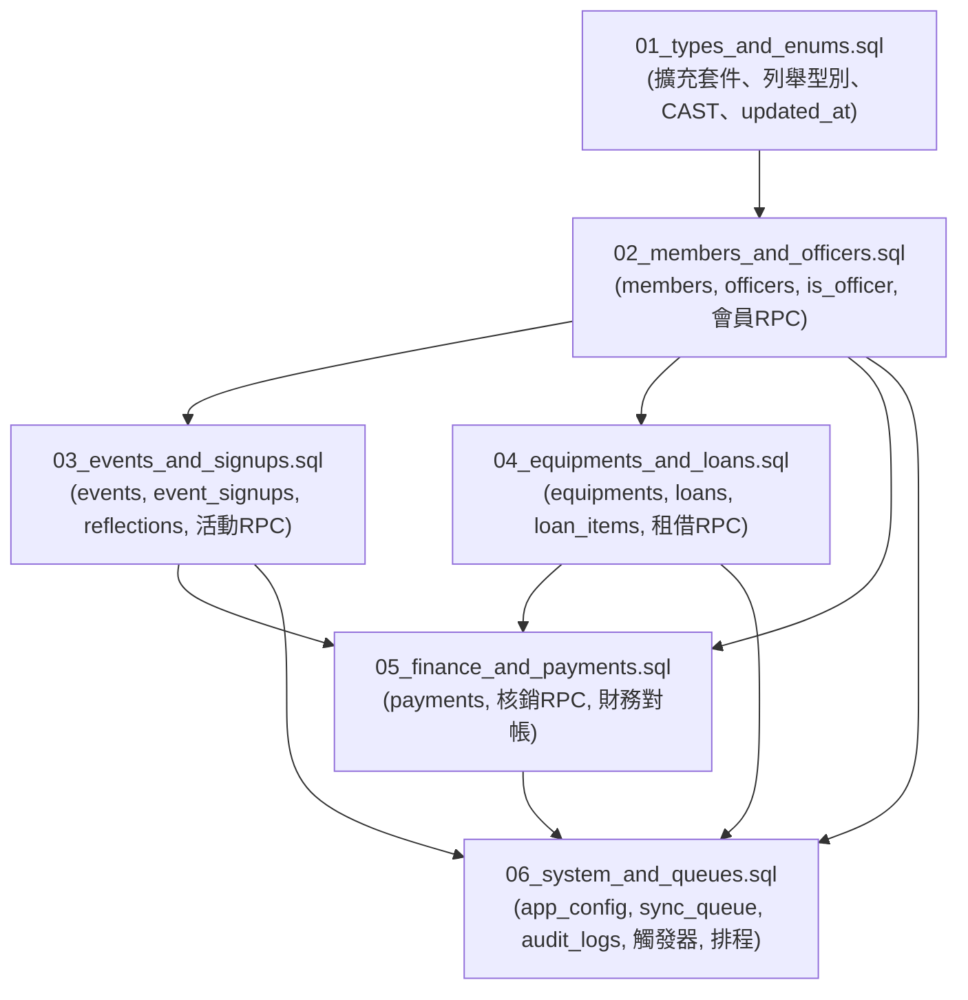

# 國立臺灣科技大學登山社 Supabase 資料庫單一真值綱要 (Single Source of Truth)

本目錄 (`supabase/schema/`) 為國立臺灣科技大學登山社社團系統之資料庫權威架構定義。所有資料表結構、自訂列舉型別、觸發器、列級安全防護 (RLS) 以及預存程序 (RPC) 均以此目錄下的檔案為唯一基準（SSOT, Single Source of Truth）。

---

## 模組劃分與執行相依順序

本目錄下的 SQL 程式檔依據實體關聯與外鍵相依性嚴格排序，初始化或全新部署時必須依照下列順序執行，或直接執行 `00_master_schema.sql`：



### 模組檔案清單

1. **`01_types_and_enums.sql`**：
   - 擴充套件啟用：`uuid-ossp`, `pg_trgm`。
   - 自訂 ENUM：`event_signup_status_enum`, `payment_status_enum`, `equipment_category`。
   - 安全 CAST 函式：`text_to_payment_status_enum`（嚴格維持 Unpaid 優先權）、`text_to_event_signup_status_enum`。
   - 通用觸發函式：`set_updated_at()`。

2. **`02_members_and_officers.sql`**：
   - 資料表：社員資料表 (`members`)、幹部名冊 (`officers`)。
   - 鑑權核心函式：`is_officer(p_line_user_id)`（防偽冒、JWT Claim 與雙軌資料表核對）。
   - 幹部快取：`sync_officer_cache_rpc`。
   - 會員端 RPC：`get_member_profile`、`save_member_profile`、`get_my_dashboard`。
   - 幹部管理 RPC：`get_admin_members_rpc`、`get_admin_member_detail_rpc`、`get_admin_member_records_rpc`、`update_admin_member_rpc`。
   - 相關資料表之 RLS 存取政策。

3. **`03_events_and_signups.sql`**：
   - 資料表：活動資料表 (`events`)、活動報名名冊 (`event_signups`)、心得評價牆 (`reflections`)。
   - 部分唯一索引：`idx_event_signups_active_unique`（排除已取消狀態之唯一性保證）。
   - 會員端 RPC：`signup_rpc`（原子報名防呆、180天個資檢驗）、`cancel_event_signup_rpc`、`save_reflection_rpc`、`get_event_public_reflections_rpc`、`get_my_achievements`。
   - 幹部管理 RPC：`get_admin_events_rpc`、`save_admin_event_rpc`、`update_event_status_rpc`、`get_admin_event_signups_rpc`、`update_signup_status_rpc`。
   - 相關資料表之 RLS 存取政策。

4. **`04_equipments_and_loans.sql`**：
   - 資料表：裝備品項庫存 (`equipments`)、裝備租借主訂單 (`loans`)、租借細項明細 (`loan_items`)。
   - 核心 RPC：`update_equipment_images`、`submit_equipment_loan_rpc`（原子扣減庫存、社團出隊0元、社員5折、2天起租計費）、`cancel_equipment_loan_rpc`、`get_admin_loans_rpc`、`update_admin_loan_status_rpc`。
   - 相關資料表之 RLS 存取政策。

5. **`05_finance_and_payments.sql`**：
   - 資料表：繳費申報表 (`payments`)。
   - 核心 RPC：`submit_payment_rpc`（後端重算金額、verify_token 生成、0元免審自動核銷、多筆合併）、`verify_payment_by_token`（免登入單鍵核銷）、`get_my_payment_history`、`get_unpaid_items_rpc`、`get_unpaid_payments`、`get_admin_finance_rpc`、`update_admin_payment_status_rpc`。
   - 相關資料表之 RLS 存取政策。

6. **`06_system_and_queues.sql`**：
   - 資料表：`app_config`, `webhook_events`, `worker_failures`, `sync_queue`, `admin_notification_digest_queue`, `audit_logs`。
   - 觸發器防護函式：`trg_fn_enqueue_sync`、`trg_fn_auto_fill_member_name`、`trg_fn_sync_member_name_to_children`。
   - 系統定時排程與巡檢：`invoke_daily_patrol`、`invoke_admin_digest`、`rls_auto_enable`。
   - 相關資料表之 RLS 存取政策。

7. **`00_master_schema.sql`**：
   - 完整整合 01 ~ 06 之單一總綱要程式檔，供一鍵式初始化與部署。

---

## 14 大核心資料表對齊總覽

| 資料表名稱 | Google Sheets 對應分頁 | 主鍵 | 說明 |
| :--- | :--- | :--- | :--- |
| `members` | `members` | `line_user_id` (TEXT) | 社員個資、登山經歷、體能測驗證明、語系偏好與正式社籍狀態 |
| `officers` | `officers` | `line_user_id` (TEXT) | 幹部名冊、職稱頭銜、職責說明與管理角色 |
| `events` | `events` | `id` (TEXT) | 活動行程、雙語中英對照、費用、日期、LINE群組與名冊試算表 |
| `event_signups` | `event_signups` | `id` (TEXT) | 活動隊員報名名冊、錄取審核狀態、繳費狀態與推播通知紀錄 |
| `equipments` | `equipments` | `id` (TEXT) | 裝備庫存品項、分類、2天基本租金、續租加成與圖片陣列 |
| `loans` | `loans` | `id` (TEXT) | 裝備租借主訂單、借還日期、訂單狀態、租金押金與快照 |
| `loan_items` | `loan_items` | `id` (BIGINT) | 租借單各裝備品項與數量細項明細 |
| `payments` | `payments` | `id` (TEXT) | 繳費申報記錄、末五碼、單鍵核銷 Token 與幹部審核備註 |
| `reflections` | `reflections` | `id` (BIGINT) | 活動心得評價、公開設定、難度美景星級、登頂相片 |
| `app_config` | - (系統組態) | `key` (TEXT) | 系統動態設定 (如 ADMIN_GROUP_ID, SUPABASE_URL) |
| `webhook_events` | - (系統去重) | `webhook_event_id` (TEXT) | LINE Webhook 冪等性去重表 |
| `worker_failures`| - (系統失敗重試) | `id` (BIGINT) | GAS Worker 非同步處理失敗紀錄與重試計數 |
| `sync_queue` | - (系統佇列) | `id` (BIGINT) | Supabase 與 Google Sheets 背景同步佇列表 |
| `admin_notification_digest_queue` | - (系統推播佇列) | `id` (UUID) | 幹部社務彙整推播佇列表 |
| `audit_logs` | - (安全稽核) | `id` (BIGINT) | 重要操作與登入軌跡安全稽核日誌 |

---

## 35 支線上即時 RPC 函式索引

本目錄已 100% 涵蓋目前線上資料庫運行之 35 支 RPC 函式：

### 會員與幹部模組 (02_members_and_officers.sql)
1. `is_officer(p_line_user_id TEXT)` -> `BOOLEAN`
2. `sync_officer_cache_rpc(p_name TEXT, p_officer_line_user_id TEXT, p_role TEXT)` -> `JSONB`
3. `get_member_profile(p_line_user_id TEXT)` -> `JSONB`
4. `save_member_profile(p_data JSONB, p_line_user_id TEXT)` -> `JSONB`
5. `get_my_dashboard(p_line_user_id TEXT)` -> `JSONB`
6. `get_admin_members_rpc(p_officer_line_user_id TEXT)` -> `JSONB`
7. `get_admin_member_detail_rpc(p_officer_line_user_id TEXT, p_target_user_id TEXT)` -> `JSONB`
8. `get_admin_member_records_rpc(p_officer_line_user_id TEXT, p_target_user_id TEXT)` -> `JSONB`
9. `update_admin_member_rpc(p_data JSONB, p_officer_line_user_id TEXT, p_target_user_id TEXT)` -> `JSONB`

### 活動與報名模組 (03_events_and_signups.sql)
10. `signup_rpc(p_event_id TEXT, p_line_user_id TEXT, p_signup_id TEXT)` -> `JSONB`
11. `cancel_event_signup_rpc(p_line_user_id TEXT, p_reason TEXT, p_signup_id TEXT)` -> `JSONB`
12. `get_admin_events_rpc(p_officer_line_user_id TEXT)` -> `JSONB`
13. `save_admin_event_rpc(p_event_data JSONB, p_officer_line_user_id TEXT)` -> `JSONB`
14. `update_event_status_rpc(p_event_id TEXT, p_officer_line_user_id TEXT, p_status TEXT)` -> `JSONB`
15. `get_admin_event_signups_rpc(p_event_id TEXT, p_officer_line_user_id TEXT)` -> `JSONB`
16. `update_signup_status_rpc(p_event_id TEXT, p_officer_line_user_id TEXT, p_review_result TEXT, p_signup_id TEXT)` -> `JSONB`
17. `save_reflection_rpc(p_details JSONB, p_line_user_id TEXT)` -> `JSONB`
18. `get_event_public_reflections_rpc(p_event_id TEXT)` -> `JSONB`
19. `get_my_achievements(p_line_user_id TEXT)` -> `JSONB`

### 裝備庫存與租借模組 (04_equipments_and_loans.sql)
20. `update_equipment_images(p_equip_id TEXT, p_images JSONB)` -> `JSONB`
21. `submit_equipment_loan_rpc(p_details JSONB, p_line_user_id TEXT)` -> `JSONB`
22. `cancel_equipment_loan_rpc(p_line_user_id TEXT, p_loan_id TEXT)` -> `JSONB`
23. `get_admin_loans_rpc(p_officer_line_user_id TEXT)` -> `JSONB`
24. `update_admin_loan_status_rpc(p_loan_id TEXT, p_notes TEXT, p_officer_line_user_id TEXT, p_status TEXT)` -> `JSONB`

### 財務與核銷模組 (05_finance_and_payments.sql)
25. `submit_payment_rpc(p_details JSONB, p_line_user_id TEXT)` -> `JSONB`
26. `verify_payment_by_token(p_officer_name TEXT, p_payment_id TEXT, p_verify_token TEXT)` -> `JSONB`
27. `get_my_payment_history(p_line_user_id TEXT)` -> `JSONB`
28. `get_unpaid_items_rpc(p_line_user_id TEXT)` -> `JSONB`
29. `get_unpaid_payments(p_line_user_id TEXT)` -> `JSONB`
30. `get_admin_finance_rpc(p_officer_line_user_id TEXT)` -> `JSONB`
31. `update_admin_payment_status_rpc(p_line_user_id TEXT, p_notes TEXT, p_notification_status TEXT, p_officer_line_user_id TEXT, p_officer_name TEXT, p_payment_id TEXT, p_source_type TEXT, p_status TEXT, p_target_id TEXT, p_target_type TEXT)` -> `JSONB`

### 系統與型別轉換 (01_types_and_enums.sql & 06_system_and_queues.sql)
32. `text_to_payment_status_enum(val TEXT)` -> `payment_status_enum`
33. `text_to_event_signup_status_enum(val TEXT)` -> `event_signup_status_enum`
34. `invoke_daily_patrol()` -> `void`
35. `rls_auto_enable()` -> `void`

---

## 核心安全規範與最佳實踐

1. **Trigger 防遞迴守衛**：
   所有觸發器函式開頭一律強制具備：
   ```sql
   IF pg_trigger_depth() > 1 THEN
       RETURN NEW;
   END IF;
   ```
   杜絕連動觸發時之 `stack depth limit exceeded` 遞迴錯誤。

2. **嚴格的 search_path 設定**：
   所有 `SECURITY DEFINER` 函式均強制配置：
   ```sql
   SET search_path = public
   ```
   徹底防禦搜尋路徑劫持攻擊。

3. **RLS 行級安全機制**：
   - 預設所有公開資料表均啟用 RLS。
   - `service_role` 具備完整存取權限。
   - 幹部身分依賴 JWT Claim `(auth.jwt() ->> 'is_officer')::boolean = true` 與內部 `is_officer()` 函式雙軌查驗。
   - 一般社員僅可讀取或更新本人之個資、報名名冊、租借訂單與繳費申報。
